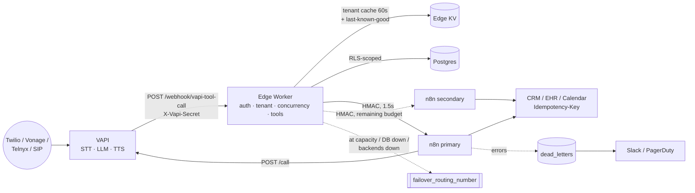

# Enterprise Voice AI Platform — Reference Architecture (VAPI + n8n)

A multi-tenant kit for running VAPI voice agents with n8n orchestration under GDPR,
HIPAA, TCPA and PIPEDA constraints, with a tested client-onboarding pipeline. It is a
**starting point to adapt**, not a turnkey deployment. Every file marks the decisions
that depend on your use case.

```
voice-ai-platform/
├── README.md                       ← architecture, decisions, how to run the tests (this file)
├── docs/
│   ├── compliance-guardrails.md    ← control matrix: regulation → control → enforcement point
│   └── reliability.md              ← retries, idempotency, state, DLQ, runbook
├── onboarding/
│   ├── client_config.schema.json   ← JSON Schema for client_config.json (compliance rules built in)
│   ├── language-map.json           ← en-US / fr-CA / es-US → Deepgram, ElevenLabs, Cartesia, scripts
│   ├── provision.mjs               ← validate → (dry-run plan | --apply: Postgres, VAPI, edge KV)
│   ├── lib/build.mjs               ← pure config → assistant / squad / phone-binding specs
│   ├── examples/acme.client_config.json
│   └── test/                       ← unit + integration (real Postgres, mock VAPI/Cloudflare)
├── edge/
│   ├── worker.ts                   ← Cloudflare Worker: auth, tenant routing, concurrency, failover, tools
│   └── test/worker.harness.mjs     ← runs the real worker against Postgres + mock n8n/VAPI
├── vapi/
│   ├── assistant.base.json         ← reference shape (real specs are generated by onboarding)
│   └── tools.json                  ← tool (function) definitions
├── n8n/
│   ├── 01-vapi-events.json         ← async events: end-of-call-report, status-update, hang
│   ├── 02-outbound-dialer.json     ← TCPA/CRTC-gated outbound call placement
│   ├── 03-tool-backends.json       ← system-of-record calls for tools (1 s SoR budget)
│   └── 99-error-handler.json       ← global error workflow → DLQ + alert
├── db/schema.sql                   ← Postgres: RLS, consent/DNC, concurrency leases, audit
└── api/openapi.yaml                ← contract: VAPI→edge, edge→n8n, admin API
```

---

## 1. The one decision that shapes everything

**n8n is behind the edge, not in front of VAPI.** Every millisecond a tool call takes is
dead air on the phone. An n8n webhook execution (queue mode → Redis → worker →
Postgres execution write) routinely adds 150–600 ms of overhead before your logic
runs, and spikes under load. More importantly, n8n can't enforce a deadline on itself:
if it hangs, the caller waits until VAPI's timeout. So the platform splits traffic by
latency class:

| Class | Examples | Handler | Budget |
|---|---|---|---|
| **Hot / sync** | `assistant-request` (+ concurrency gate), `transfer-destination-request`, `request_opt_out`, PHI gating, idempotency | Edge → Postgres/KV directly | < 300 ms |
| **Warm / sync** | `verify_identity`, `check_availability`, `book_appointment` | Edge → n8n primary (1.5 s) → n8n secondary (rest) → live SIP transfer. **Hard 2,500 ms cap.** | VAPI tool timeout 3 s |
| **Cold / async** | `end-of-call-report`, CRM sync, outbound dialing, retries | n8n | seconds–minutes |

VAPI is configured with `POST {EDGE}/webhook/vapi-tool-call` as the single server URL
for every message type, matching the blueprint path. The edge also accepts
`/vapi/events` and `/vapi/tools` as aliases.

## 2. Topology



### Failure behaviour (all tested, see §5)

| Situation | What the caller experiences |
|---|---|
| Number at `max_concurrent_calls` | `assistant-request` returns a transfer `destination`: hears the busy message, goes to the failover line. No AI, no dead air. |
| n8n primary slow / down | Secondary answers inside the 2.5 s budget. The caller hears the tool's filler line, then the answer. |
| Both n8n down / hanging | At ≤ 2.5 s the tool says "transferring you to a team member", then the edge live-transfers the call via `call.monitor.controlUrl`. |
| Postgres down, tenant in cache | Ringing calls go straight to the failover line (tools would fail anyway). |
| Postgres down, cache cold | Last-known-good KV copy supplies the failover number. |
| Unknown number | 403 → VAPI ends the call. It is never routed to another tenant's assistant. |
| Lost "ended" event | Concurrency lease expires after `maxDurationSeconds` + 2 min. |

### Multi-tenancy model

- **Tenant resolution key = the dialed number** (`call.phoneNumberId`). Outbound calls
  carry server-set `metadata.tenantId`, which must agree with the number's owner. Tool
  arguments are never trusted for tenancy, because the LLM writes them.
- **Isolation in Postgres via forced RLS.** Every query runs with a transaction-local
  `app.tenant_id`. The few pre-tenant lookups (`resolve_tenant_by_vapi_phone`,
  `acquire_call_slot`, `phone_number_owner`) are narrow `SECURITY DEFINER` functions
  owned by a `BYPASSRLS` owner role. The app role can't bypass RLS.
- **Onboarding refuses to claim a number another tenant owns** before it touches VAPI.
- **One VAPI org, many tenants** by default; one org per tenant for HIPAA/enterprise
  clients that need separate BAAs, keys, or residency.

### Language handling

The blueprint asked for a tool-call response that updates `assistant.transcriber.language`
mid-call. I disagree: VAPI doesn't let a tool result change the live call's transcriber
or voice. Onboarding gives you two supported options instead, selected by
`localization.auto_detect_language`:

| Mode | How | Use when |
|---|---|---|
| `false` (squad) | One assistant per locale, each with the right Deepgram code (`en-US`, `fr-CA`, `es-419` for es-US) and voice, in a VAPI squad with `assistantDestinations` handoffs between every pair. | Accuracy matters, e.g. Québécois French. |
| `true` (multilingual) | One assistant, Deepgram `language: "multi"`, multilingual TTS model, prompt rule "reply in the caller's language". | Fewer moving parts. Weaker on regional accents. |

## 3. Client onboarding

```bash
cd onboarding && npm ci
node provision.mjs examples/acme.client_config.json            # validate + print full plan (no writes)
EDGE_BASE_URL=... DATABASE_URL=... VAPI_API_KEY=... VAPI_WEBHOOK_SECRET=... \
CF_ACCOUNT_ID=... CF_API_TOKEN=... CF_KV_NAMESPACE_ID=... \
node provision.mjs clients/acme.json --apply
```

`--apply` runs these steps, each idempotent (re-running PATCHes; it never duplicates):
1. Upserts the tenant as `pending`.
2. Refuses any number owned by another tenant.
3. Checks each number is already imported into VAPI. Carrier credentials stay out of this tool.
4. Creates or updates the per-language assistants, persisting each id immediately so a crash can't orphan resources.
5. Creates or updates the squad.
6. Binds each number to the edge with no static assistant, so `assistant-request` (and the concurrency gate) runs on every call.
7. Registers `max_concurrent_calls`, writes the edge KV profile, and busts the cache.
8. Activates the tenant. DB constraints refuse activation for HIPAA without a BAA date or Quebec without a PIA date.

What the schema enforces, so a bad config fails before anything is created:
- Secrets anywhere in the file are rejected (`additionalProperties: false`).
- HIPAA requires a BAA date, forces recording off, and caps retention at 30 days.
- `CA-QC` requires a PIA date and French support. `EU-*` requires a DPIA date.
- The default language must be in the supported list.
- The failover number can't be one of the client's own AI numbers, which would loop.
- `REPLACE_*` placeholder voice ids block `--apply`.
- It warns if `server_url` points directly at n8n.

## 4. Latency budget (inbound turn, target ≈ 800–1,100 ms voice-to-voice)

| Stage | Target | Lever |
|---|---|---|
| Endpointing | 200–400 ms | `startSpeakingPlan.smartEndpointingPlan`, tune `waitSeconds` |
| STT final | 100–200 ms | Streaming STT, correct per-locale `language` |
| LLM first token | 250–450 ms | Small model (`gpt-4.1-mini` / Groq), short system prompt |
| Tool round-trip (if any) | < 300 ms typical, 2,500 ms cap | Edge-local checks, SoR timeout 1 s, co-locate DB with VAPI region |
| TTS first byte | 100–200 ms | `eleven_flash_v2_5`, `optimizeStreamingLatency: 3` |

`assistant-request` adds one edge round trip during ringing (tested at ~10–30 ms
against a local DB). That cost buys the concurrency gate and the DB-down failover.

## 5. Status and verification

| Artifact | What was run |
|---|---|
| `db/schema.sql` | Postgres 16, loaded as a **non-superuser** `BYPASSRLS` owner, exercised as the app role: RLS read/write isolation; HIPAA/Quebec activation gates; `can_dial` (FL 8 PM, US 9 PM / 8 AM, missing tz, unknown region, marketing without written consent, DNC); fair cross-tenant job claim; backoff; idempotent call ingest; append-only audit. **Concurrency: 20 simultaneous `acquire_call_slot` against max 3 → exactly 3 granted**, idempotent resend, release, lease expiry. |
| `edge/worker.ts` | `tsc --strict`. `edge/test/worker.harness.mjs` runs the real worker against Postgres with mock n8n primary/secondary/events and a mock VAPI `controlUrl`: **16/16 pass**. Covers secret check, concurrency gate and failover destination, slot release, slow primary → secondary in 1.64 s, both hanging → answer at 2.52 s, live transfer POST, idempotent tool replay, PHI gating, opt-out → DNC row, DB-down failover from cache and from last-known-good, unknown number → 403. |
| `onboarding/` | **12/12 tests**: schema and cross-field rules, squad / multilingual / HIPAA builds; `--apply` against real Postgres + mock VAPI/Cloudflare (creates 3 assistants + squad, binds the number, activates); second run issues only PATCHes; a second client claiming the same number is refused with **zero** VAPI calls; a missing VAPI import is reported. |
| Edge ↔ n8n HMAC | Worker's WebCrypto signer vs n8n Code-node verifier; tamper and stale rejected. |
| `n8n/*.json` | Valid JSON, all connections resolve, every Code node and expression parses. |
| `api/openapi.yaml` | swagger-parser validation. |

Bugs these tests caught and fixed before commit:
- Dialer RLS bug: every tenant except the last got a null caller ID.
- Functions failed from a default `search_path`.
- Onboarding could silently "claim" another tenant's number.
- A cached tenant with the DB down threw on `assistant-request` instead of failing over.

**Not tested against live services.** Before production:
- **VAPI field names.** Verify against the current API reference:
  - squad `assistantDestinations`
  - the `destination` response to `assistant-request`
  - `call.monitor.controlUrl` and its `transfer` body
  - nulling `assistantId`/`squadId` on a phone number
  - `compliancePlan`
- **Deepgram codes.** Verify `fr-CA` and `es-419` for your chosen model, and `multi` availability.
- **n8n import.** Re-bind `REPLACE_*` credentials and set the Error Workflow. Allow `crypto` in Code nodes. Move `$env.*` to credentials/Variables if your release blocks env access.
- **Idempotency-Key.** Your system of record **must** dedupe on it (= VAPI `toolCallId`). The secondary-n8n retry can otherwise double-book.
- **VAPI's own org concurrency limit** applies on top of `max_concurrent_calls`.
- **Legal review.** Get counsel to sign off on `docs/compliance-guardrails.md` for your use case.

### Running the tests

```bash
# Postgres 16: create roles, load schema as the owner
psql -c "CREATE ROLE voice_owner NOLOGIN BYPASSRLS; CREATE ROLE voice_app LOGIN;"
psql -c "CREATE EXTENSION IF NOT EXISTS pgcrypto; GRANT CREATE ON DATABASE <db> TO voice_owner;"
psql -c "SET ROLE voice_owner" -f db/schema.sql      # then the GRANTs at the bottom of schema.sql
cd onboarding && npm ci && TEST_DATABASE_URL=postgres://voice_app@localhost/<db> npm test
cd ../edge && npm ci && npx tsc -p . && EDGE_TEST_DB=postgres://voice_app@127.0.0.1/<db> npm test
```
Both suites seed their own tenants with unique ids per run, so they can be re-run against the same database.
