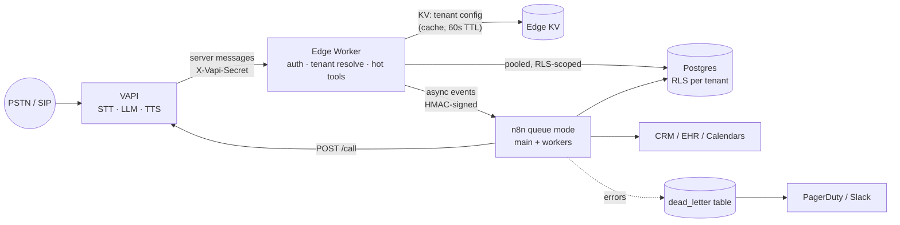

# Enterprise Voice AI Platform — Reference Architecture (VAPI + n8n)

A multi-tenant reference kit for running VAPI voice agents with n8n orchestration
under GDPR, HIPAA, TCPA and PIPEDA constraints. It is a **starting point to adapt**,
not a turnkey deployment — every file marks the decisions that depend on your use case.

```
voice-ai-platform/
├── README.md                     ← architecture, latency budget, decisions (this file)
├── docs/
│   ├── compliance-guardrails.md  ← control matrix: regulation → control → enforcement point
│   └── reliability.md            ← retries, idempotency, state, DLQ, runbook
├── edge/worker.ts                ← Cloudflare Worker: auth, tenant routing, hot-path tools
├── vapi/
│   ├── assistant.base.json       ← tenant-agnostic assistant template
│   └── tools.json                ← tool (function) definitions
├── n8n/
│   ├── 01-vapi-events.json       ← async events: end-of-call-report, status-update
│   ├── 02-outbound-dialer.json   ← TCPA/CRTC-gated outbound call placement
│   ├── 03-tool-backends.json     ← system-of-record calls for tools (3 s budget)
│   └── 99-error-handler.json     ← global error workflow → DLQ + alert
├── db/schema.sql                 ← Postgres w/ row-level security, consent, idempotency
└── api/openapi.yaml              ← contract for tool + admin endpoints
```

---

## 1. The one decision that shapes everything

**n8n is not on the synchronous voice path.** Every millisecond a tool call takes is
dead air on the phone. An n8n webhook execution (queue mode → Redis → worker →
Postgres execution write) routinely adds 150–600 ms of overhead before your logic
runs, and spikes under load. So the platform splits traffic by latency class:

| Class | Examples | Handler | Budget (p95) |
|---|---|---|---|
| **Hot / sync** | `assistant-request`, `transfer-destination-request`, `request_opt_out`, identity/PHI gating, idempotency | Edge worker → Postgres/KV directly | < 300 ms |
| **Warm / sync** | Tools that need a system of record (`verify_identity`, `check_availability`, `book_appointment`) | Edge → n8n `03-tool-backends` → CRM/EHR, **hard 3.5 s deadline** with spoken fallback | < 1,500 ms |
| **Cold / async** | `end-of-call-report`, CRM sync, summaries, outbound dialing, retries | n8n | seconds–minutes |

If you only have budget for one runtime, keep n8n and accept the latency — but put
`request-start` filler messages on every tool (see `vapi/tools.json`) and mark
write tools `async: true` where the caller doesn't need the result.

## 2. Topology



### Multi-tenancy model

- **Tenant resolution key = the dialed number.** Inbound: `message.call.phoneNumberId`
  → `phone_numbers.tenant_id`. Outbound: the `tenantId` you put in
  `assistantOverrides.metadata` when creating the call. Never trust a tenant ID
  from tool arguments — the LLM writes those.
- **One VAPI org, many assistants** for SMB tenants; **one VAPI org per tenant**
  for enterprise/HIPAA tenants that need separate BAAs, keys, or data residency.
  The `tenants.vapi_org_mode` column records which.
- **Isolation in Postgres via RLS** (`db/schema.sql`): every connection sets
  `app.tenant_id`; policies enforce it. A forgotten `WHERE tenant_id =` cannot leak.
- **Per-tenant secrets** (CRM tokens, EHR creds) live in a secrets manager keyed by
  tenant, never in n8n credentials shared across tenants.

### Secure webhook routing

1. VAPI → edge only. n8n's webhook URLs are not internet-reachable except via the
   edge (Cloudflare Tunnel / private network / IP allowlist).
2. Edge verifies `X-Vapi-Secret` in constant time (per-tenant secret when
   per-tenant orgs are used), rejects bodies > 1 MB, enforces a 5 s clock window
   on its own signed forwards to n8n.
3. Edge → n8n forwards are re-signed with HMAC-SHA256 over
   `timestamp + "." + body` (`X-Edge-Signature`, `X-Edge-Timestamp`), so n8n never
   has to trust the public internet.
4. Every request carries `X-Request-Id` end to end for trace correlation.

## 3. Latency budget (inbound turn, target ≈ 800–1,100 ms voice-to-voice)

| Stage | Target | Lever |
|---|---|---|
| Endpointing (caller stops → turn ends) | 200–400 ms | `startSpeakingPlan.smartEndpointingPlan`, tune `waitSeconds` |
| STT final | 100–200 ms | Streaming STT, `nova-3`-class model, correct `language` |
| LLM first token | 250–450 ms | Smaller model for routing, short system prompt, prompt caching |
| Tool round-trip (if any) | < 300 ms | Edge handler, co-locate DB with VAPI region, connection pooling |
| TTS first byte | 100–200 ms | Streaming TTS, `optimizeStreamingLatency`, avoid SSML-heavy voices |

Rules that actually move p95:
- **Co-locate** edge DB and n8n in the same cloud region as your VAPI deployment.
- **Return speakable strings** from tools (`"Tuesday at 3 PM is open"`), not JSON
  blobs the LLM has to re-narrate.
- **Cap tool output** at ~500 chars; large payloads inflate LLM latency on the next turn.
- **Cache `assistant-request`** tenant config at the edge. VAPI waits a few seconds
  for this response and the caller hears ringback the entire time.

## 4. Status and verification

What was actually tested:

| Artifact | Check |
|---|---|
| `db/schema.sql` | Loaded into Postgres 16. Tested as a non-owner role: RLS read/write isolation, HIPAA/Quebec activation gates, `can_dial` (FL 8 PM cutoff, US 9 PM, 8 AM, missing tz, unknown region, marketing without written consent, DNC), fair cross-tenant job claim + `SKIP LOCKED`, backoff, idempotent call ingest, append-only audit. |
| `edge/worker.ts` | `tsc --strict` against `@cloudflare/workers-types` + `postgres`. |
| Edge ↔ n8n HMAC | Signed with the worker's WebCrypto code, verified with the n8n Code-node logic; tamper and stale-timestamp rejected. |
| `n8n/*.json` | Valid JSON, all connections resolve, every Code node and `={{ }}` expression parses. |
| `api/openapi.yaml` | Validated with swagger-parser. |

What was **not** tested: anything against live VAPI or a running n8n instance. Before production:

- Re-check VAPI field names against the current API reference — VAPI renames
  fields between versions (e.g. `hipaaEnabled` → `compliancePlan.hipaaEnabled`,
  `serverUrl` → `server.url`). Treat `vapi/*.json` as the shape, not gospel.
- Import n8n workflows into a staging instance; re-bind credentials (`REPLACE_*` IDs),
  set the Error Workflow ID, and confirm node `typeVersion`s match your n8n release.
  The Code nodes need `NODE_FUNCTION_ALLOW_BUILTIN=crypto`; expressions read `$env.*`,
  which newer n8n releases block by default (`N8N_BLOCK_ENV_ACCESS_IN_NODE`). Move those
  values to credentials or Variables if so.
- Wire `vapi/tools.json` into the edge's `buildAssistant()` (currently abbreviated) or
  create a saved assistant per tenant and set `tenants.vapi_assistant_id`.
- Get counsel to sign off on `docs/compliance-guardrails.md` for your actual
  use case and jurisdictions. It is an engineering control map, not legal advice.
